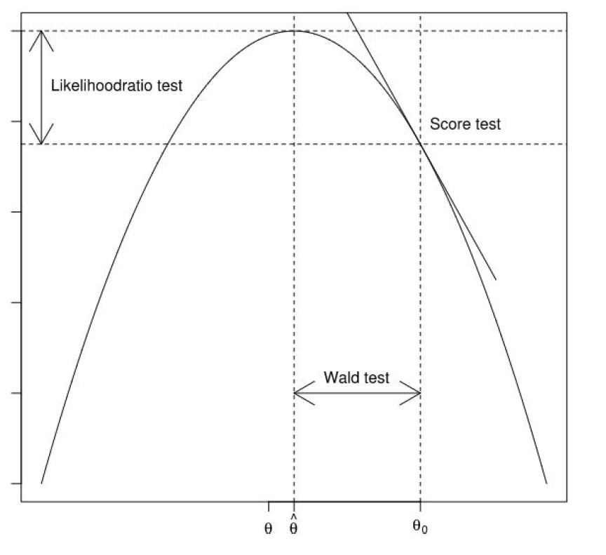

# Modelo lineal generalizado

```{r, include=FALSE}
knitr::opts_chunk$set(echo = TRUE)
knitr::write_bib(c("knitr", "stringr"), "", width = 60)

logdose <- c(1.6907, 1.7242, 1.7552, 1.7842, 1.8113, 1.8369, 1.8610, 1.8839)
dead <- c(6, 13, 18, 28, 52, 53, 61, 60) # numbers dead
n <- c(59, 60, 62, 56, 63, 59, 62, 60) # binomial sample sizes
Datos=data.frame(logdose,n,dead)
DatosEsc = Datos
colnames(DatosEsc) = c('log. dosis','expuestos', 'muertos')
```


## Datos de escarabajos {-}
En un estudio de toxicología, se está interesado en la tasa de mortalidad de escarabajos expuestos a disulfuro de carbono gaseoso. La Tabla \@ref(tab:TmortEsc) muestra el número de escarabajos muertos después de cinco horas de exposición de este tóxico a diferentes concentraciones del químico. Podemos ver que a medida que aumenta la dosis, la mortalidad de escarabajos va aumentando.

```{r TmortEsc, echo=FALSE}
knitr::kable(
  head(DatosEsc[, 1:3], 8), booktabs = TRUE,
  caption = 'Número de escarabajos expuestos y muertos a diferentes dosis (escala logarítmica) de disulfuro de carbono gaseoso.'
)
```

En la Figura \@ref(fig:grafMortEsc) podemos observar como es el aumento de la tasa de mortalidad con respecto a la dosis del tóxico. Note que la relación no es lineal, si no que tiene una forma de 'S'. Esto hace que un modelo de regresión lineal sea inadecuado (además una línea recta permitiría estimaciones por debajo de cero y encima de 1). Una alternativa es utilizar una transformación que describa la relación de forma adecuada y que garantice que la respuesta se encuentre dentro del espacio del parámetro. Es decir, que la estimación de la proporción de escarabajos muertos esté entre $0$ y $1$.

```{r grafMortEsc, echo=T, fig.height = 4, fig.width = 6, fig.align='center', fig.cap="Datos de mortalidad de escarabajos. Relación entre la concentración de disulfuro de carbono gaseoso (en escala logarítmica) y la proporción de muertes (muertos/expuestos) de los escarabajos."}
logdose <- c(1.6907, 1.7242, 1.7552, 1.7842, 1.8113, 1.8369, 1.8610, 1.8839)
dead <- c(6, 13, 18, 28, 52, 53, 61, 60) 
n <- c(59, 60, 62, 56, 63, 59, 62, 60) 
plot(logdose,dead/n,xlab='logaritmo de la dosis de disulfuro de carbono gaseoso',ylab='proporción de muertos',ylim=c(0,1),pch=16)
```


## Datos de Ataques de epilepsia {-}
Los datos ```data(epilepsy)``` de la librería ```HSAUR2``` corresponden a un ensayo clínico para evaluar el efecto del fármaco Progabida sobre los ataques epilépticos. Al inicio del estudio, los $59$ pacientes epilépticos fueron observados durante 8 semanas, y se registró el número de convulsiones. Luego, fueron aleatorizados al tratamiento con el fármaco Progabide ($31$ pacientes) o al grupo de placebo ($28$ pacientes). A los pacientes de ambos grupos se les observo durante cuatro períodos de dos semanas y se registró el número de convulsiones.

Estos datos son de naturaleza longitudinal (cada paciente cuenta con 4 observaciones tomadas en el tiempo), lo que requiere metodologías que tengan en cuenta la correlación que hay en los datos. En es caso, no consideraremos las observaciones intermedias de cada paciente, sino solamente las mediciones tomadas luego de las cuatro semanas de observación.

```{r seizureData, echo=T,message=F,warning=F}
library(HSAUR2)
data(epilepsy)
epilepsy4= epilepsy[epilepsy$period==4,]
```

Las variables que se tendrán en cuenta son las siguientes:
* ```age```: edad del paciente,

* ```base```: número de ataques epilépticos en las 8 semanas antes de iniciar los tratamientos,

* ```treatment```: tratamiento (placebo, Progabida),

* ```seizure.rate```(variable respuesta): número de ataques epilépticos en las últimas dos semanas al final de estudio (luego cuatro semanas de tratamiento).

La Figura \@ref(fig:seizurePlot) muestra la relación del número de ataques epiléticos al final del estudio con las posibles covariables. Aquí vemos que no parece haber relación con la edad, hay una relación positiva fuerte con el número de ataques pre-tratamiento, y que los pacientes del grupo placebo parecen  presentar un poco más de convulsiones luego de las 8 semanas de tratamiento.

```{r seizurePlot, echo=F, fig.height = 4, fig.width = 10,fig.align = "center", fig.cap="Datos de epilepsia. Relación entre el número de ataques epilépticos con la edad, ataques previos (izquierda) y el tratamiento (derecha)."}
epilepsy4= HSAUR2::epilepsy[HSAUR2::epilepsy$period==4,]

par(mfrow=c(1,3))
plot(seizure.rate~age, col=treatment, pch=16, data=epilepsy4, xlab="edad",
     ylab = "núm. de ataques post-tratamiento (ataques x 2 semanas)")
plot(seizure.rate~base, col=treatment, pch=16,data=epilepsy4,
     xlab="núm. de ataques pre-tratamiento (ataques x 4 semanas)",
     ylab = "núm. de ataques post-tratamiento (ataques x 2 semanas)")
boxplot(seizure.rate~treatment,data=epilepsy4, xlab = "tratamiento",
        ylab = "núm. de ataques post-tratamiento (ataques x 2 semanas)")
```

## Familia exponencial
La distribución de probabilidad de una variable aleatoria $Y$ pertenece a la **familia exponencial** si la función de densidad (o masa) de $Y$ se puede expresar de la siguiente forma:
$$
f(y;\theta,\phi)=\exp\{[y\theta-b(\theta)]/a(\phi)+c(y,\phi)\},
$$

donde $\theta$ es llamado parámetro natural, y $\phi>0$ es un parámetro de dispersión. Además se tiene que:
$$
E[Y]=b'(\theta) \quad \text{y} \quad V[Y]=b''(\theta)a(\phi).
$$

De la definición de una función de densidad, sabemos que $\int f(y;\theta)dy = 1$. Diferenciando sobre $\theta$ a ambos lados, obtenemos que:
\begin{equation}
\int \frac{\partial}{\partial \theta} f(y;\theta)dy = 0,
(\#eq:dervfy)
\end{equation}
y
\begin{equation}
\int \frac{\partial^2}{\partial \theta^2} f(y;\theta)dy = 0.
(\#eq:dervfy2)
\end{equation}

A partir de (\@ref(eq:dervfy), tenemos:
$$
\int \frac{\partial f(y; \theta)}{\partial \theta}dy = \int \frac{y-b'(\theta)}{a(\phi)}f(y;\theta)dy = \frac{E(y)-b'(\theta)}{a(\phi)} = 0.
$$
Resolviendo la ecuación para se obtiene que $E(y) = b'(\theta)$. 

A partir de (\@ref(eq:dervfy2) se puede obtener la varianza:
\begin{equation}
\begin{split}
\int \frac{\partial^2 f(y; \theta)}{\partial \theta^2}dy &= \int \left[\frac{y-b'(\theta)}{a(\phi)}\right]^2f(y;\theta)dy - \int b''(\theta)f(y;\theta)dy  \\
&= \frac{1}{a(\phi)^2} \int [y - b'(\theta)]^2f(y; \theta)dy - b''(\theta)  \\
&= \frac{V[y]}{c(\phi)^2} - b''(\theta) = 0.
\end{split}
\nonumber
\end{equation}
Resolviendo la ecuación llegamos a la expresión de la varianza $V(y) = b''(\theta)a(\phi)$.

Por ejemplo, la distribución Poisson pertenece a la familia exponencial. Para demostrarlo, la función de densidad de la distribución Poisson:

$$
f(y;\mu)=\frac{\lambda^y\exp(-\lambda)}{y!},
$$

se puede reescribir como:

$$
f(y;\lambda)=\exp(-\lambda+y\log\lambda-\log y!).
$$
Por lo tanto, la distribución Poisson pertenece a la familia exponencial con $\theta=\log\mu$, $b(\theta)=\exp(\theta)$, $a(\phi)=1$ y $c(y,\phi)=-\log y!$.

La distribución normal también pertenece la familia exponencial. Su función de densidad,

$$
f(y;\mu,\sigma^2)=\frac{1}{\sqrt{2\pi\sigma}}\exp\left[-\frac{(y-\mu   )^2}{2\sigma^2}\right],
$$

se puede reescribir como:

$$
f(y;\mu,\sigma^2)=\exp\left[\frac{y\mu-\frac{1}{2}\mu^2}{\sigma^2}-\frac{1}{2}\log(2\pi\sigma^2)-\frac{y^2}{2\sigma^2}\right],
$$

donde $\theta=\mu$, $b(\theta)=\frac{1}{2}\theta^2$, $a(\phi)=\sigma^2$ y $c(y,\phi)=-\frac{1}{2}log(2\pi\sigma^2)-\frac{y^2}{2\sigma^2}$.

Finalmente, también la distribución binomial pertenece a la familia exponencial. Su función densidad,

$$
f(y;\pi)=\left(\begin{array}{c}n\\y\end{array}\right)\pi^y(1-\pi)^{n-y}.
$$
se puede reescribir como:

$$
f(y;\pi)=\exp\left\{y[\log\pi-\log(1-\pi)]+n\log(1-\pi)+\log\left(\begin{array}{c}n\\y\end{array}\right)\right\},
$$
donde $\theta=log\left(\frac{\pi}{1-\pi}\right)$, $b(\theta)=-n\log\left[1+\exp(\theta)\right]$, $c(\phi)=1$ y $d(y,\phi)=\log\left(\begin{array}{c}n\\y\end{array}\right)$.

### Relación media-varianza:
Para algunas distribuciones de probabilidad hay una relación directa entre la media y la varianza. Por ejemplo, para la distribución binomial tenemos que:
\[
E(Y) = \mu = n\pi \mbox{ y } V(Y) =  n\pi(1-\pi),
\]
por lo que $V(Y) = \nu(\mu) = \mu(1-\mu)/n$.

Para la distribución Poisson, tenemos que $V(Y) = \nu(\mu) = \mu$. Es decir, la varianza es igual a la media. Mientras que, para la distribución normal, la media y la varianza son parámetros independientes.

## Definición del modelo lineal generalizado
Un modelo lineal generalizado (GLM) está definido por tres componentes: 

* **Componente aleatorio:** definición de la variable respuesta $Y$ y su distribución de probabilidad.

* **Predictor lineal:** $\eta=\bx^{'}\bbeta$, donde $\bbeta$ es un vector de parámetros y $\bx$ un vector de covariables.

* **Función de enlace:** una función $g$ que conecta la media de la variable respuesta, $E(Y)$, con el predictor lineal, $\eta$, $g[E(Y|\bx)]=\bx'\bbeta$.

### Componente aleatorio

Se asume que se cuenta con $n$ observaciones independientes $(y_{i},...,y_{n})$ de una variable aleatoria $Y$ cuya distribución de probabilidad pertenece a la **familia exponencial.** Restringir un GLM a esta familia permite tener expresiones generales para la función de verosimilitud y funciones score, la distribución asintótica de los estimadores de los parámetros del modelo, y el algoritmo para ajustar el modelo.

Por ejemplo, para los datos de los escarabajos podemos asumir que el número de escarabajos que mueren, para cada dosis del químico, sigue una distribución binomial. Mientras que en el caso del ensayo clínico en epilepsia, se podría asumir que el número de ataques epilépticos, condicionado a las covariables, sigue una distribución Poisson.

### Predictor lineal

Para cada observación $i$, tenemos un conjunto de covariables observadas,

$$
\bx_{i}=(1,x_{i1},...,x_{i,p-1})^{'},
$$

donde $x_{ij}$ es la $j$-ésima covariable asociada al individuo $i$. Entonces, el predictor lineal está definido como:
$$
\eta_{i}=\beta_{0}+\sum_{j=1}^{p-1}\beta_{j}x_{ij}=\bx_{i}^{'}\bbeta.
$$

### Función de enlace

En algunas distribuciones,$E(Y|\bx)$ está acotada en un intervalo. Por ejemplo, en la distribución binomial, $0\leq \pi_{i}\leq 1$, o en la Poisson, $\lambda_{i}>0$. Esto hace que no siempre sea razonable asumir una relación lineal entre $E(Y | \bx)$ y $\bx$. Por lo que la función de enlace conecta $E(Y|\bx)$ con el predictor lineal $\eta$ a través de una función $g()$:

$$
E(Y|\bx)=g^{-1}(\eta)=g^{-1}(\bx^{'}\bbeta),
$$
donde, la función $g(\cdot)$ es monótona y diferenciable. Generalmente, $g(\cdot)$ está determinada por la distribución que se asume para $Y$.


### Ejemplos
#### Datos de escarabajos {-}
Entendiendo que se está estudiando la proporción de escarabajos muertos para cierta dosis del tóxico, esta variable se puede modelar a partir de una distribución Bernoulli. Sea:
\[
y_{ij} = \begin{cases}
1 & \mbox{ si el escarabajo }j \mbox{ expuesto a la dosis }i\mbox{ muere,} \\
0 & \mbox{ si lo contrario.}
\end{cases}
\]
Por lo que, para la $i$-ésima dosis, el número de escarabajos que muere es igual a $y^*_i=\sum_{j=1}^{n_i} y_{ij}$. Además, asumiendo independencia, podemos decir que:
$$
y^*_i \sim \mbox{binomial} (n_{i},\pi_{i}), i=1,\ldots,n_i,
$$
donde $0 < \pi_i < 1$ depende de la dosis. Definiendo $y_{i}=y^*_i/n_{i}$ (la proporción de escarabajos muertos para la dosis $i$), tenemos que:
$$
E(y_{i}| \mbox{dosis}_{i}) = \pi_{i} \mbox{ y }V(y_{i}|  \mbox{dosis}_{i}) = \pi_{i}(1-\pi_{i})/n_{i}.
$$

Dado que $0 \leq \pi_i \leq 1$, se podría proponer que:
$$
\pi_{i} = g^{-1}(\mbox{dosis},\bbeta) =  \frac{\exp(\beta_0 + \log \ \mbox{dosis}_i\beta_1)}{1+\exp(\beta_0 + \log \ \mbox{dosis}_i\beta_1)} =\frac{\exp(\eta_i)}{1+\exp(\eta_i)}.
$$
Por lo que $g(\pi_{i}) = \log \left( \frac{\pi_{i}}{1-\pi_{i}}\right) = \eta_i$. Esta función recibe el nombre de función logit y su forma la podemos ver gráficamente en la Figura \@ref(fig:logfun). Como vemos, está función está acotada entre $0$ y $1$, garantizando que las probabilidades estimadas siempre estén en este rango, y tiene forma de 'S'.

```{r logfun, echo=FALSE, fig.height = 4, fig.width = 6,fig.align = "center",fig.cap = "Función logit."}
x= seq(from=-8,to=8,length.out = 1000)
curve(1/(1+exp(-x)),-8,8,lwd=2,ylab='y',xlab='log[y/(1-y)]')
abline(h=0,lty=2,lwd=1)
abline(h=1,lty=2,lwd=1)
```

#### Modelo Poisson para el número de ataque epilépticos {-}
Considerando que tenemos una variable respuesta de tipo conteo podemos modelarla a partir de una distribución Poisson. Definiendo $y_i$ como el número de ataques epilépticos ($\times$ dos semanas) del paciente $i$ luego de 8 semanas de tratamiento, podemos suponer que:
$$
y_{i}\sim \mbox{Poisson}(\lambda_{i}), \quad i=1,...,n,\quad \text{donde} \quad \lambda_{i}=g(\eta_i),
$$
donde $\eta_i = \beta_{0}+\beta_{1}\text{treat}_{i}+\beta_{2}\text{base}_{i}+\beta_{3}\text{base}_{i}\text{treat}_{i}.$ Entonces, $E(y_{i}|\bx_{i})=V(y_{i}|\bx_{i})=\lambda_{i}$. Dado que $\lambda_ i > 0$, se puede asumir que:
$$
\lambda_{i}=g^{-1}(\eta_i)=\exp(\eta_i).
$$

Por lo que, $g(\lambda_{i})=\log\lambda_{i}$. Este modelo puede ser una opción para estimar el número medio de ataques epiléticos de los pacientes del ensayo clínico en epilepsia. 

#### Otros ejemplos {-}
Un modelo lineal es un caso particular del GLM. Aquí asumimos que $y_i \sim N(\mu_i, \sigma^2)$, con $\mu_i = \bx_i'\bbeta$. Esto es, la función de enlace es la identidad. 

Otros ejemplos de distribuciones que se pueden utilizar son:

* **Modelo binomial-negativo** para conteo con sobredispersión.
* **Modelo beta-binomial** para ensayos Bernoulli correlacionados (sobredispersión).
* **Modelo multinomial** para variables nominales (ordinales) con más de dos categorías.
* **Modelo beta** para proporciones.
* **Modelo gamma** para variables continuas asimétricas y con varianza creciente.
* **Modelo Weibull** para tiempos de falla.

### Especificación del modelo 
El GLM asume que la variable $y_i$ sigue una distribución que pertenece a la familia exponencial. Por lo tanto, se tiene que:

$$
f(y_{i};\theta_{i},\phi)=\exp\left\{\frac{y_{i}\theta_{i}-b(\theta_{i})}{a(\phi)} +c(y_{i},\phi)\right\},
$$
donde $\phi>0$. Además, $E(y_{i})=b'(\theta_{i})$ y $V(y_{i})=b''(\theta_{i})a(\phi).$ 

El predictor lineal $\eta_{i}=\bx'_{i}\bbeta$ se relaciona con $\mu_{i}$ a través la función de enlace, $\eta_{i}=g(\mu_{i})$. 

La función de enlace $g(\cdot)$  que transforma $\mu_{i}$ en el parámetro natural $\theta_{i}$ es llamada **función de enlace canónica.** Por ejemplo para la distribución normal, $\eta_{i}=\mu_{i}$ (identidad), por lo tanto $\mu_{i}=\eta_{i}$. Para la distribución Poisson, $\eta_{i}=\log\mu_{i}$, por lo tanto $\mu_{i}=\exp(\eta_{i})$. Para la distribución binomial, $\eta_{i}=\log\left(\frac{\pi_{i}}{1-\pi_{i}}\right)$, por lo tanto  $\pi_{i}=\frac{\exp(\eta_{i})}{1+\exp(\eta_{i})}$.

## Estimador de máxima verosimilitud
Dado que asumimos que la distribución de probabilidad asociada a la variable resputa pertenece a la familia exponencial y que las observaciones son independientes, la función de log-verosimilitud está definida como:
$$
\ell(\bbeta)=\sum_{i=1}^{n}\ell_{i}(\bbeta)=\sum_{i=1}^{n}\log f(y_{i};\theta_{i},\phi)=\sum_{i=1}^{n}\left[\frac{y_{i}\theta_{i}-b(\theta_{i})}{a(\phi)}+c(y_{i},\phi)\right].
$$
Para encontrar las funciones score debemos resolver:
\[
\frac{\partial \ell_{i}(\bbeta)}{\partial \beta_j} = \frac{\partial \ell_{i}(\bbeta)}{\partial \theta_{i}} \frac{\partial \theta_{i}}{\partial \mu_{i}} \frac{\partial \mu_{i}}{\partial \eta_{i}} \frac{\partial \eta_{i}}{\partial \beta_j},
\]
para $j=0,\ldots,p-1$. Sabemos que $\mu_{i} = b'(\theta_{i})$ y $V(y_{i})=b''(\theta_{i})a(\phi)$. Por lo tanto:
\[
\frac{\partial \ell_{i}(\bbeta)}{\partial \theta_{i}} = \frac{y_{i} - b'(\theta_{i})}{a(\phi)} = \frac{y_{i} - \mu_{i}}{a(\phi)},
\]
y
\[
\frac{\partial \mu_{i}}{\partial \theta_{i}} = b''(\theta_{i}) = \frac{V(y_{i})}{a(\phi)}.
\]
Además, $\frac{\partial \mu_{i}}{\partial \eta_{i}}$ depende de la función de enlace, y 
\[
\frac{\partial \eta_{i}}{\beta_{j}} = \frac{\partial}{\beta_{j}} \bx_{i}'\bbeta = x_{ij}.
\]
Por lo que:
\[
\begin{split}
\frac{\partial \ell_{i}(\bbeta)}{\partial \beta_j} &= \frac{\partial \ell_{i}(\bbeta)}{\partial \theta_{i}} \frac{\partial \theta_{i}}{\partial \mu_{i}} \frac{\partial \mu_{i}}{\partial \eta_{i}} \frac{\partial \eta_{i}}{\partial \bbeta} \\
&= \frac{y_{i} - b'(\theta_{i})}{a(\phi)} \frac{a(\phi)}{V(y_{i})}\frac{\partial \mu_{i}}{\partial \eta_{i}} x_{ij},
\end{split}
\]
Sumando sobre las $n$ observaciones encontramos las funciones score:
\[
u(\beta_{j}) = \sum_{i=1}^{n} \frac{(y_{i}- \mu_{i})x_{ij}}{V(y_{i})}\frac{\partial \mu_{i}}{\partial \eta_{i}} = 0, \mbox{ para }j=0,\ldots,p-1.
\]
donde $\eta_{i} = \bx_{i}'\bbeta = g(\mu_{i})$.

En forma matricial, la expresión anterior se expresa como:
\[
\bu(\bbeta) = \bX'\bD\bV^{-1}(\by - \bmu) = \bZERO,
\]
donde $\bV$ es una matriz diagonal con valores $v_{ii} = V(y_{i})$ y $\bD$ es una matriz diagonal con valores $d_{ii} = \frac{\partial \mu_{i}}{\partial \eta_{i}}$.

Los elementos de la matriz de información son:
\[
\begin{split}
E\left[ - \frac{\partial^{2}\ell_{i}(\bbeta)}{\partial \beta_{j}\partial\beta_{h}} \right] =& E\left[ \frac{\partial\ell_{i}(\bbeta)}{\partial \beta_{j}} \frac{\partial\ell_{i}(\bbeta)}{\partial \beta_{h}} \right] \\
=& E\left[ \frac{(y_{i}-\mu_{i})x_{ij}}{V(y_{i})}\frac{\partial \mu_{i}}{\partial \eta_{i}} \frac{(y_{i}-\mu_{i})x_{ih}}{V(y_{i})}\frac{\partial \mu_{i}}{\partial \eta_{i}} \right]  \\
=& \frac{x_{ij}x_{ih}}{V(y_{i})^{2}}\left( \frac{\partial \mu_{i}}{\partial \eta_{i}} \right)^{2} E\left[ (y_{i}-\mu_{i})^2 \right] \\
=& \frac{x_{ij}x_{ih}}{V(y_{i})}\left( \frac{\partial \mu_{i}}{\partial \eta_{i}} \right)^{2}.
\end{split}
\]
De forma matricial, la matriz de información es $\bI(\bbeta) = \bX'\bW\bX$, donde $\bW$ es una matriz diagonal con $w_{ii} = \frac{(\partial \mu_{i}/\partial \eta_{i})^{2}}{V(y_{i})}$.


Para encontrar el estimador por máxima verosimilitud, tenemos que resolver la función score:
\[
\bu(\bbeta) = \bX'\bD\bV^{-1}(\by - \bmu) = \bZERO,
\]
para $\bbeta$. Dado que $\bu(\bbeta)$ es una función no-lineal, es necesario estimar $\bbeta$ iterativamente. Utilizando el algoritmo de Newton-Raphson, tenemos que:
\[
\bbeta^{(t+1)} = \bbeta^{(t)} + \bI\left(\bbeta^{(t)}\right)^{-1}\bu(\bbeta^{(t)}) = \bbeta^{(t)} + \left[ \bX'\bW^{(t)}\bX \right]^{-1}\bX'\bD^{(t)}\left(\bV^{(t)}\right)^{-1}(\by-\bmu^{(t)}).
\]

### Mínimos cuadrados iterativamente reponderados
La estimación por máxima verosimilitud usando el algoritmo de Fisher-Scoring se puede ver como un estimador de mínimos cuadrados ponderados (MCP). Recordemos que para un modelo lineal de la forma:
\[
\bz = \bX\bbeta + \bvarepsi,
\]
y asumiendo que $\bvarepsi \sim N(\bZERO,\bV)$ con $\bV$ diagonal, el estimador por MCP está dado por $(X'\bV^{1}\bX)^{-1}\bX'\bV^{-1}\bZ$.

La función score en el GML se puede expresar también como $\bu(\bbeta) = \bX'\bW\bD^{-1}(\by- \bmu)$. Además, el algoritmo de Fisher-Scoring requiere resolver el siguiente sistema de ecuaciones:
\[
\left[ \bX'\bW^{(t)}\bX \right]\bbeta^{(t+1)} = \left[ \bX'\bW^{(t)}\bX \right]\bbeta^{(t)} + \bX'\bW^{(t)}\left(\bD^{(t)}\right)^{-1}\left(\by- \bmu^{(t)}\right) = \bX'\bW^{(t)} \left[ \bX'\bbeta^{(t)} +\left(\bD^{(t)}\right)^{-1}\left(\by- \bmu^{(t)}\right)\right] = \bX'\bW^{(t)}\bz^{(t)}.
\]
Por lo que, se puede encontrar el MLE de $\bbeta$ de forma iterativa así:
\[
\bbeta^{(t+1)} = (\bX'\bW^{(t)}\bX)^{-1}\bX'\bW^{(t)}\bz^{(t)}
\]
donde, los elementos del vector $\bz^{(t)}$ son $z_{i}^{(t)} = \bx_{i}'\bbeta^{(t)} + \left(y_{i}- \mu_{i}^{(t)} \right)\frac{\partial \eta_{i}^{   (t)}}{\partial \mu_{i}^{(t)}}$.

A este estimador, que es equivalente al MLE, se le llama estimador de mínimos cuadrados iterativamente reponderados.

### Distribución del MLE
La distribución asintótica del MLE de $\bbeta$ $(n \rightarrow \infty)$ es:
\[
\hatbbeta \sim N\left[ \bbeta, (\bX'\bW\bX)^{-1} \right],
\]
donde $\bW$ es una matriz diagonal con $w_{ii} = \frac{(\partial \mu_{i}/\partial \eta_{i})^{2}}{V(y_{i})}$. Note que $\bW$ dependen de la función g, ($\partial \mu_{i}/\partial \eta_{i} = g'(\mu_{i})$).

### Implementación en R

#### Ajuste e interpretación de parámetros del modelo logístico
Para los datos de mortalidad de escarabajos, tenemos el siguiente modelo:

$$
y_i^* \sim \mbox{binomial}(n_i,\pi_i), \mbox{ donde } \pi_{i}=\frac{\exp(\beta_0+\beta_1\log\ \text{dosis}_i)}{1+\exp(\beta_0+\beta_0\log\ \text{dosis}_i)}.
$$
La estimación de los parámetros del GLM por MLE se puede hacer utilizando la función ``glm()``. En esta función debemos determinar la distribución de probabilidad asociada a los datos y la función de enlace con el argumento ``family``. Para el modelo logístico, usamos ``family=binomial`` (por defecto la función de enlace es logit):
```{r escarabajosEst}
modBin = glm(cbind(dead,n-dead)~logdose,family=binomial)
summary(modBin)
```
Aquí vemos que el efecto del logaritmo de la dosis es positivo y significativo. Un incremento en la dosis significa un aumento en la probabilidad de que el escarabajo muera. La relación la podemos ver de forma gráfica en la figura \@ref(fig:escarabajosEstFig).

```{r escarabajosEstFig, fig.height = 4, fig.width = 6,fig.align = "center",fig.cap = "Datos de mortalidad de escarabajos. Estimación de la probabilidad de que el escarabajo muera en función del logarítmo de la dosis de disulfuro de carbono gaseoso."}
pred.x = data.frame(logdose = seq(min(logdose),max(logdose),length.out = 50))
pred = predict(modBin,pred.x,type='response')

plot(logdose,dead/n,xlab='log dosis de disulfuro de carbono gaseoso',ylab='proporción de escarabajos muertos',ylim=c(0,1))
lines(pred.x$logdose,pred,col=2,lwd=2)
```

La interpretación de los coeficientes del modelo logístico se hacen a través de los **odds ratio**. Primero, un **odd** está definido como:

$$
\mbox{odd}=\frac{P(Y=1)}{P(Y=0)}.
$$
Es decir, es una razón entre la probabilidad de éxito sobre la probabilidad de fracaso. Por ejemplo, si el odd es igual a dos, estaríamos diciendo que la probabilidad de éxito es el doble de la probabilidad de fracaso. Para el caso del modelo logístico simple, tenemos que:

$$
\text{odd}(x)=\frac{P(Y=1|x)}{P(Y=0|x)}= \frac{\frac{\exp(\beta_0+x\beta_1)}{1+\exp(\beta_0+x\beta_1)}}{1-\frac{\exp(\beta_0+x\beta_1)}{1+\exp(\beta_0+x\beta_1)}} = \exp(\beta_0+x\beta_1).
$$

Ahora, los **odds ratio** están definido como $\text{OR}=\frac{\text{odd}(x=a+1)}{\text{odd}(x=a)}$. Para el caso del modelo logístico simple tenemos que el OR es:

$$
\mbox{OR}(x)=\frac{\text{odd}(x=a+1)}{\text{odd}(x=a)}=\frac{\exp\left[\beta_{0}+(a+1)\beta_{1}\right]}{\exp(\beta_0+a\beta_1)}=\exp(\beta_1).
$$

Por lo tanto, por cada cambio unitario en $x$, los odds de morir incrementan por un factor de $exp(\beta_1)$. Por un cambio en $x$ de $a$ a $a+\delta$, tenemos que $OR=\exp(\delta\beta_1)$.

Para los datos de los escarabajos un cambio unitario en el log dosis es muy grande, por lo que podríamos interpetra $\beta_1$ usando un aumento en la log dosis mas pequeño, por ejemplo de $\delta=0.02$:

$$
\exp ( 0.02\times  34.270) = 1.984.
5.
$$
Por lo que, si el log de la concentración de aumenta en $0.02$, entonces la probabilidad de que el escarabajo muera aumenta casi el doble.

#### Ajuste e interpretación de parámetros del modelo Poisson

Para el ensayo clínico en epilepsia, el modelo propuesto es:
$$
y_i \sim \mbox{Poisson}(\lambda_i), \mbox{ donde } \lambda_i=\exp(\beta_0+\beta_1\text{treat}_i+\beta_2\text{base}_i+\beta_2\text{base}_i\text{treat}_i).
$$
Para el ajuste del modelo usamos la función `glm()` con el argumento `family=poisson`:
```{r ajusteSeizure}
modPois=glm(seizure.rate~treatment+base+base:treatment,family=poisson,
            data =epilepsy4)
summary(modPois)
```
Los resultados del ajuste muestran que el número de ataques pre-tratamiento tiene un efecto positivo sobre la media del número de ataques epilépticos. Esto significa que esta es mayor para pacientes con más ataques previos. Mientras que, el tratamiento parece tener un efecto negativo. Es decir, los pacientes que tomaron prograbide tienen una media de ataques epilépticos menor con respecto a los que tomaron el placebo. Finalmente, el efecto interacción es muy pequeño sugiriendo que el efecto del tratamiento no se ve afectado por la frecuencia de los ataques epilépticos que tiene el paciente. La estimación de la media se puede observa de forma gráfica en la Figura \@ref(fig:ajusteSeizureFig).

```{r ajusteSeizureFig,fig.height = 4, fig.width = 6,fig.align = "center",fig.cap="Datos de epilepsia. Estimación de la media de ataques epilépticos (por dos semanas) luego de cuatro semanas de tratamiento. La línea negra representa la media de ataques para el grupo placebo, mientras que, la linea roja la media de ataques para el tratamiento con Progabide."}
y = data.frame(base=seq(min(epilepsy4$base),max(epilepsy4$base),length.out=100),
               treatment = factor(1:2, levels = 1:2, labels = levels(epilepsy4$treatment)))
predpois = predict(modPois,y,type='response')
x=seq(min(epilepsy4$base),max(epilepsy4$base),length.out=50)

plot(seizure.rate~base, col=treatment, pch=16,data=epilepsy4,
     xlab="ataques pre-tratamiento (x 4 semanas)",
     ylab = "ataques post-tratamiento (x 2 semanas)")
lines(x,predpois[order(y$treatment, y$base)[1:50]], lwd = 2)
lines(x,predpois[order(y$treatment, y$base)[51:100]],col=2, lwd = 2)
```

En el modelo Poisson simple, tenemos que $E(Y|x)=\exp(\beta_0+x\beta_1)$. Si aumentamos a $x$ en $\delta$ unidades, tenemos que $E(Y|x+\delta)=\exp(\beta_0+(x+\delta)\beta_1)$. Ahora si calculamos el logaritmo de la razón de los valores esperados obtenemos que:

$$
\log\left[\frac{E(Y|x=a+\delta)}{E(Y|x=a)}\right]=\delta\beta_1.
$$

Por lo tanto, $\exp(\delta\beta_1)=\frac{E(Y|x=a+\delta)}{E(Y|x=a)}$. Es decir que, $\exp(\delta\beta_1)$ es una tasa de crecimiento del valor esperado de $Y$ por un aumento en $x$ de $\delta$ unidades.

Por ejemplo, una diferencia de 10 ataques epilépticos pre-tratamiento entre pacientes se asocia con un incremento en la media de ataques post-tratamiento de aproximadamente del 23\% ($\exp(0.0209\times10)$) para el grupo control.Mientras que para el grupo tratamiento este incremento es del 24\% ($\exp[(0.0209+0.0009)\times10)$)). Note que $\beta_3$ no es significativo, por lo que esta diferencia no es significativa. Finalmente, el tramiento con Progabida reduce en un poco más del 40\% el número de episodios de epilepsia $(\exp(-0.3635857) = 0.695)$.


## Pruebas de hipótesis
Al igual que en los modelos lineales, uno puede estar interesado en realizar pruebas hipótesis sobre los coeficientes del modelo. Por ejemplo, en el estudio sobre epilépsia estamos interesados en evaluar si hay un efecto significativo del tratamiento sobre los ataques epilépticos. Esto es:
$$
\qquad H_0:\beta_1=\beta_3=0.
$$
Si rechazamos $H_0$ podemos concluir que el tratamiento con Progabida tiene un efecto sobre el número de ataques epilépticos. Particularmente, si $\beta_1 < 0$, este fármaco reduce los episodios.

Suponga que tenemos un modelo con el siguiente predictor lineal:
$$
\eta = \bx_{1}'\bbeta_1+\bx_{2}'\bbeta_2,
$$
donde $\bx_{1 }= (1,x_{11},\ldots,x_{1,q-1})'$ y $\bx_{2}= (1,x_{21},\ldots,x_{2,p-q})'$ son vectores de covariables; $\bbeta_1$ y $\bbeta_2$ son vectores de coeficientes de dimensiones $q$ y $p-q$, respetivamente. Ahora, planteamos el siguiente sistema de hipótesis:
$$
\qquad H_0:\bbeta_2=\bZERO \qquad H_1:\bbeta_2 \ne \bZERO.
$$
Para estimadores basados en verosimilitud, podemos utilizar tres métodos diferentes: la prueba de razón de verosimilitud, la prueba del score o la prueba de Wald.

### Prueba de razón de verosimilitud
Este método se basa en una aproximación de la función de verosimilitud usando series de Taylor de orden 2, alrededor de $\bbeta=\hatbbeta$,
\[
\ell(\bbeta) \approx \ell(\hatbbeta) + (\bbeta - \hatbbeta)\bu(\hatbbeta)  - \frac{1}{2} (\bbeta - \hatbbeta)'\bI(\hatbbeta)(\bbeta - \hatbbeta).
\]
Dado que $\bu(\hatbbeta)=\bZERO$,
\[
\ell(\bbeta) - \ell(\hatbbeta) =  - \frac{1}{2} (\bbeta - \hatbbeta)'\bI(\hatbbeta)(\bbeta - \hatbbeta).
\]
Por lo tanto:
\[
LR= 2 \left[\ell(\hatbbeta) - \ell(\bbeta)\right] = (\bbeta - \hatbbeta)'\bI(\hatbbeta)(\bbeta - \hatbbeta).
\]
Además, de forma asintótica se tiene que $LR\sim \chi^{2}_{p}$.

Teniendo en cuenta este resultado, para evaluar:
\[
H_{0}: \bbeta_{2} = \bZERO \qquad H_{1}: \bbeta_{2} \neq \bZERO,
\]
se puede utilizar el siguiente estadístico de prueba:
$$
LR = 2 [\ell(M_1) - \ell(M_0)],
$$
donde $\ell(M_1)$ es la log-verosimilitud lograda en el modelo completo y $\ell(M_0)$ la log-verosimilitud lograda en el modelo reducido (asumiendo $H_0$ como cierta). Bajo $H_0$, tenemos que, asintóticamente, $LR \sim \chi^{2}_{p-q}$. Por lo que, rechazamos $H_0$ con un nivel de significancia de $\alpha$, si $LR > \chi^{2}_{1-\alpha,p-q}$.


### Prueba del Score
Recordemos que la función score es:
$$
u(\beta_{j}) = \sum_{i=1}^{n} \frac{(y_{i}- \mu_{i})x_{ij}}{V(y_{i})}\frac{\partial \mu_{i}}{\partial \eta_{i}} = 0, \mbox{ para }j=0,\ldots,p-1,
$$
donde $g(\mu_{i}) = \eta_{i} = \bx_{i}'\bbeta$. Además, tenemos que $E[\bu(\bbeta)] =\bZERO$ y $V[\bu(\bbeta)] = \bI(\bbeta)$. Si asumimos que $\bu(\bbeta) \sim N[\bZERO, \bI(\bbeta)]$, entonces:
$$
\bu(\bbeta)'\bI(\bbeta)^{-1}\bu(\bbeta) \sim \chi^{2}_{p}.
$$
Basado en este resultado, para evaluar:
$$
H_{0}: \bbeta_{2} = \bZERO \qquad H_{1}: \bbeta_{2} \neq \bZERO,
$$
usando el siguiente estadístico de prueba:
$$
\bu_2(\hatbbeta^{0})'\bI(\hatbbeta^{0})^{-1}\bu_2(\hatbbeta^{0}) \sim \chi^2_{p-q},
$$
donde $\hatbbeta^{0} = (\hatbbeta_1',\bZERO')'$.

### Prueba de Wald
El estadístico de Wald se basa en la distribución asintótica de $\hatbbeta$,
$$
\hatbbeta \sim N(\bbeta,I(\bbeta)^{-1})
$$
De aquí tenemos que $(\hatbbeta - \bbeta)'\bI(\bbeta)(\hatbbeta - \bbeta) \sim \chi^2_{p}$. Por lo que, para probar:
$$
H_{0}: \bbeta_{2} = \bZERO \qquad H_{1}: \bbeta_{2}^{0} \neq \bZERO,
$$
usando el siguiente estadístico de prueba:
$$
(\hatbbeta_2 - \hatbbeta_2^{0})'\bI(\hatbbeta_2)(\hatbbeta_2 - \hatbbeta_2^{0})\sim \chi_{p-q}.
$$

La Figura \@ref(fig:pruebaHipotesis) ilustra las diferencias conceptuales entre las pruebas de hipótesis para un parámetro $\theta$, bajo la hipótesis nula $H_0:\theta=\theta_0$. La prueba de razón de verosimilitud evalúa si la diferencia entre la log-verosimilitud maximizada en $\hattheta$ y la log-verosimilitud bajo $H_0$ es estadísticamente significativa. La prueba del score examina si la función score, evaluada bajo $H_0$, difiere significativamente de cero. Por su parte, la prueba de Wald evalúa si la distancia entre $\hattheta$ y $\theta_0$ es estadísticamente significativa.

```{r pruebaHipotesis, echo=FALSE, out.width="60%", fig.align="center", fig.cap="Diferencias conceptuales de las pruebas de hipótesis"}

```

Considere el siguiente ejemplo sencillo donde se quiere realizar sobre una prueba de hipótesis sobre el parametro $\pi$ de una binomial, $H_{0}: \pi=\pi_0$. A partir de una muestra de tamaño $n$, se tiene que $\hatpi=y$, donde $y$ la proporción de éxitos en la muestra. Entonces, la función de verosimilitud está dada por:
$$
\ell(\pi) =  \log{n \choose ny}+ ny\log\pi+  (n-ny)\log(1-\pi).
$$
Por lo que, el estadístico de prueba de razón de verosimilitud es:
$$
LR = 2\log\left[ ny\log\left(\frac{y}{\pi_0}\right) + n(1-y)\log\left(\frac{1-y}{1-\pi_0} \right) \right]. 
$$
La función score es:
$$
u(\pi) = \frac{\delta \ell(\pi)}{\delta \pi} = n\left( \frac{y}{\pi} - \frac{1-y}{1-\pi} \right) = n \left[\frac{y-\pi}{\pi(1-\pi)} \right] = 0,
$$
y la hessiana es:
$$
h(\pi) = \frac{\delta u(\pi)}{\delta \pi} = - n \left[ \frac{y}{\pi^2} + \frac{1-y}{(1-\pi)^2} \right],
$$
por lo que $I(\pi) = \frac{n}{\pi(1-\pi)}$. Entonces, el estadístico para la prueba de score es:
$$
n \left[\frac{y-\pi_0}{\pi_0(1-\pi_0)} \right] \left[ \frac{n}{\pi_0(1-\pi_0)} \right]^{-1}  n \left[\frac{y-\pi_0}{\pi_0(1-\pi_0)} \right] = \frac{(y-\pi_0)^2}{[\pi_0(1-\pi_0)/n]}. 
$$
Dado que se tiene que $\hatpi \sim N\left(\pi,  \pi (1-\pi)/n \right)$, el estadístico para la prueba de Wald es:
$$
\frac{(y-\pi_0)^2}{y(1-y)/n}.
$$
Los tres estadísticos de prueba difieren. Sin embargo, cuando $n \to \infty$, estos son equivalentes. Para el modelo lineal (asumiendo normalidad de la variable respuesta), los tres tipos de métodos arrojan resultados idénticos. La inferencia basada en la prueba de Wald resulta inútil cuando una estimación o un valor bajo la hipótesis nula ($H_0$) se sitúa en el límite del espacio del paramétro. Por ejemplo, en el caso anterior se plantea $H_0:\hatpi=0$.

### Implementación en R
#### Datos de ataques de epilepsia
En este caso, podríamos plantear el siguiente sistema de hipótesis:
$$
\qquad H_0:\beta_1=\beta_3=0 \qquad H_1: \beta_1=0 \mbox{ o } \beta_3=0.
$$
Aquí, $H_0$ indica que no hay ningún efecto del tratamiento para la epilépsia (no es estadísticamente diferente al placebo). La prueba de razón de verosimilitud y del score se pueden implementar de las siguiente forma:

```{r ajusteSeizureLRT,echo=TRUE}
modPois0=glm(seizure.rate~base,family=poisson,
            data =epilepsy4)
anova(modPois0,modPois,test='LRT')
anova(modPois0,modPois,test='Rao')
```
Ambos resultado, complementado con los anteriores, sugiere que hay un efecto del tratamiento. Es decir, el Progabida tiene un efecto significativo para reducir los ataques epilépticos. La prueba de Wald la podemos implementar de la siguiente forma:
```{r ajusteSeizureWald,echo=TRUE}
library(aod)
VarMat = vcov(modPois)
Coef = coefficients(modPois)
wald.test(VarMat,Coef,Terms=c(2,4))
```
Estos resultados son similares a los observados con las anteriores pruebas y llegamos a la misma conclusión.

## Intervalos de confianza
### Intervalo de confianza para los coeficientes de regresión
A partir de los estadísticos de prueba anteriores se pueden encontrar intervalos de confianza para $\bbeta$. Por ejemplo usando el estadístico de Wald:

$$
\widehat{\beta}_j\pm z_{\alpha/2}\sqrt{V(\widehat{\beta}_j)}.
$$

Otra alternativa es a partir de los perfiles de log-verosimilitud, el intervalo del $(1-\alpha)$\% de confianza para $\beta_j$ está definido a partir de los valores de $\beta^0_j$ que satisfacen:

$$
-2[\ell(\hatbbeta^{0})-\ell(\hatbbeta)]<\chi^2_{1-\alpha,1},
$$

donde $\ell(\hatbbeta^{0})$ es la máxima  log-verosimilitud alcanzada cuando el coeficiente $\beta_j$ está restringido a un valor $\beta_j^0$. En la Figura \@ref(fig:perfilverosimilitud) muestra el gráfico de contorno para la función de log-verosimilitud para la estimacion de un modelo con dos paráemtros $(\theta_1,\theta_2)$. La máxima verosimilitud se obtiene en el punto $(2.77,1.56)$ y la línea solida representa el recorrido del perfil de verosimilitud para $\theta_1$.

```{r perfilverosimilitud, echo=F, fig.align="center", fig.cap="Gráfica de contorno de la función de verosimilitud para un modelo con dos parámetros $(\\theta_1,\\theta_2)$. El punto está ubicado en la máxima verosimilitud y la línea solida el camino del perfil de verosimilitud.", fig.height=4, fig.width=6, message=FALSE, warning=FALSE, include=TRUE}
library(maxLik)
x= c(2.3, 0.7, 8.0, 4.4, 15.6, 3.0, 1.9, 1.5, 1.7, 1.0, 2.4, 0.5, 3.3, 5.7, 6.9, 8.9, 1.9, 9.0, 4.5, 3.1)

loglik.gamma = function(parm,x){
  sum(dgamma(x,parm[1],1/parm[2],log=T))
}
loglik.gamma.beta = function(parm,x,alfa){
  sum(dgamma(x,parm,1/alfa,log=T))
}

mle.gamma = maxLik(loglik.gamma,start = c(1,1),x=x,method='NR')

alfa0.1 = seq(0.5,10,length.out=500)
beta0.1 = NULL
ll0.1 = NULL
for(i in 1:length(alfa0.1)){
  if(i ==1){beta00 =2}else{beta00 = beta0.1[i-1]}
  mleEst0 = maxLik(loglik.gamma.beta,x=x,alfa=alfa0.1[i],start=beta00)
  beta0.1[i] = mleEst0$estimate
  ll0.1[i] = mleEst0$maximum
}

alp = seq(0.5,6,length.out=100)
bet = seq(0.5,6,length.out=100)
griddf <- expand.grid(alp,bet)
llr = apply(griddf,1,function(y){loglik.gamma(y,x)})
llrm = matrix(llr,nrow=100,byrow = F)

filled.contour(bet,alp,llrm,nlevels=25,
               plot.axes={
                 lines(beta0.1,alfa0.1,col=1,type='l')
                 points(mle.gamma$estimate[1],mle.gamma$estimate[2],pch=19)
                 axis(side=1)
                 axis(side=2)
               },xlab=expression(theta[2]),ylab=expression(theta[1])              
)
```

En la Figura \@ref(fig:perfilverosimilitud2) podemos ver el perfil de verosimilitud para $\beta_2$ junto con los límites del 95\% calculados a través el método del perfil de verosimilitud y el método de Wald. Se alcanza a ver que hay una diferencia entre ambos intervalos, particularmente en el límite inferior.

```{r perfilverosimilitud2, echo=F, fig.align="center", fig.cap="Gráfica del perfil de verosimilitud para $\\theta_1$. La línea solida es estimación por máxima verosimilitud de $\\theta_1$ y las líneas cortadas negras y rojas los límites del intervalo del 95% de confianza usando le método del perfil de verosimilitud y el de Wald, respectivamente.", fig.height=4, fig.width=6, message=FALSE, warning=FALSE, include=TRUE}
val =  2*(logLik(mle.gamma)-ll0.1)
cond = val < qchisq(0.95,1)
IC = range(beta0.1[cond])
confint(mle.gamma)
yl = logLik(mle.gamma)-qchisq(0.95,1)/2

plot(beta0.1,ll0.1,type='l',xlim=c(min(beta0.1),3),ylim=c(-52.8,max(ll0.1)),
     xlab=expression(theta[1]),ylab='log-versomilitud')
abline(h=yl,lty=2)
abline(v=IC,lty=2)
abline(v=mle.gamma$estimate[1])
abline(v=confint(mle.gamma)[1,],col=2,lty=2)
```

### Intervalo de confianza para la media
Dado que $\widehat{\eta}_0=\bx_0'\hatbbeta$ ,por lo tanto (asintóticamente):

$$
\widehat{\eta}_0\sim N[\bx_0'\bbeta,\bx_0'\bI(\bbeta)^{-1}\bx_0].
$$

Entonces un intervalo de confianza para $\eta_0$ es:

$$
\widehat{\eta}_0\pm z_{\alpha/2}\sqrt{\bx_0'I(\hatbbeta)^{-1}\bx_0}.
$$

Para encontrar el intervalo de confianza para $\mu_i$, se hace la transformación $g^{-1}$ a los límites de confianza.

### Implementación en R
#### Datos de escarabajos
La estimación de la probabilidad, junto con el intervalo de confianza del 95\%, de que el escarabajo muera se puede observar en la Figura \@ref(fig:grafICesc).

```{r grafICesc, fig.height = 4, fig.width = 6,fig.align = "center", include=TRUE,fig.cap = "Datos de mortalidad de escarabajos. Intervalo del 95% de confianza para la probabilidad de que el escarabajo muera.",warning=FALSE,message = FALSE}

pred.link = predict(modBin,newdata = pred.x,type='link',se.fit = T)
lim.sup = faraway::ilogit(pred.link$fit + qnorm(0.975)*pred.link$se.fit)
lim.inf = faraway::ilogit(pred.link$fit - qnorm(0.975)*pred.link$se.fit)

plot(logdose,dead/n,xlab='log dosis',ylab='proporción de escarabajos muertos',ylim=c(0,1))
lines(pred.x$logdose,pred)

lines(pred.x$logdose,lim.sup, col=2)
lines(pred.x$logdose,lim.inf, col=2)
```

#### Datos de ataque de epilepsia
Los intervalos del 95\% de confianza para los parámetros del modelo son:
```{r epilepsyic, warning=F, message=F}
confint(modPois)
```
Aquí vemos que el efecto del tratamiento está entre $-0.7$ y $-0.04$. Es decir, que la reducción del número de ataques epilépticos está a una tasa entre el 0.51 y 0.95. Mientras que, como ya se mencionó antes, el efecto interacción no tiene un aporte significativo.

La media del número de ataques epiléptico por dos semanas se puede observar en la Figura \@ref(fig:grafICepilep). Se puede ver que las estimaciones de la media para el grupo tratamiento es inferior que para el grupo control.

```{r grafICepilep, fig.height = 4, fig.width = 6,fig.align='center',fig.cap="Datos de epilépsia. Estimación de la media de ataques epilépticos por dos semanas en el grupo placebo (línea negra) y el grupo tratamiento (línea roja)."}
predx1 = data.frame(base=seq(6,151,length.out = 100),treatment='placebo')
predx2 = data.frame(base=seq(6,151,length.out = 100),treatment='Progabide')
predy1 = predict(modPois,newdata = predx1,type='response')
predy2 = predict(modPois,newdata = predx2,type='response')
predy1Link = predict(modPois,newdata = predx1,type='link',se.fit = T)
predy2Link = predict(modPois,newdata = predx2,type='link',se.fit = T)
lwr1 = exp(predy1Link$fit - qnorm(0.975)*predy1Link$se.fit)
upr1 = exp(predy1Link$fit + qnorm(0.975)*predy1Link$se.fit)
lwr2 = exp(predy2Link$fit - qnorm(0.975)*predy2Link$se.fit)
upr2 = exp(predy2Link$fit + qnorm(0.975)*predy2Link$se.fit)
plot(epilepsy4$base,epilepsy4$seizure.rate,
ylab='# ataques epilépticos (4ta semana)',
xlab='# ataques epilépticos (pre tratamiento)',
col=as.double(epilepsy4$treatment))
lines(predx1$base,predy1,lwd=2)
lines(predx1$base,predy2,col=2,lwd=2)
lines(predx1$base,lwr1,lty=2)
lines(predx1$base,upr1,lty=2)
lines(predx2$base,lwr2,lty=2,col=2)
lines(predx2$base,upr2,lty=2,col=2)
```

## Devianza
Considere un GLM con observaciones $\by=(y_1,\ldots,y_n)$. Sea $\cl(\bmu)$ la log-verosimilitud expresada en función del vector de medias $\bmu=(\mu_1,\ldots,\mu_n)$, y sea $\cl(\hat{\bmu})$ la log-verosimilitud evaluada en el MLE. Al considerar todos los modelos posibles, el valor máximo que puede alcanzar $\cl(\bmu)$ corresponde a $\cl(\by)$. Este valor se obtiene mediante un modelo con ajuste perfecto, en el que $y_i=\mu_i$ para todo $i$, denominado modelo saturado. Aunque este ajuste podría parecer ideal, carece de utilidad práctica, ya que el modelo saturado está sobreparametrizado (el número de parámetros es igual al número de observaciones). No obstante, sirve como referencia para comparar otros modelos. En este sentido, un buen modelo debería presentar una diferencia relativamente pequeña con respecto al modelo saturado.

La Devianza compara el modelo propuesto contra el modelo saturado de la siguiente manera:

\begin{equation}
\begin{split}
D(\hatbmu) &=- 2 \log \left[ \frac{L(\hatbmu)}{L(\by)} \right] = -2[\ell(\hat{\bmu})-\ell(\by)] \\
&=  2\sum_{i=1}^n[y_i\tildetheta_i-b(\tildetheta_i)]/a(\phi) - \sum_{i=1}^n[y_i\widehat{\theta_i}-b(\widehat{\theta_i})]/a(\phi),
\end{split}
\nonumber
\end{equation}

donde $\tildetheta_i$ corresponde a la estimación de $\theta_i$ en el modelo saturado $(\tildemu_i=y_i)$. Dado que, $\ell(\by) \geq \ell(\widehat{\bmu})$, entonces $D \geq 0$. Por lo que, si el ajuste propuesto es pobre, se espera que $D$ sea grande.

Bajo ciertas condiciones se puede demostrar que la devianza sigue una distribución $\chi^2$ donde los grados de libertad son iguales a la diferencia entre el número de parámetros del modelo saturado y el modelo estimado.

### Relación la prueba de razón de verosimilitud
Supongamos que tenemos un modelo $M_1$ con $p$ parámetros y otro modelo $M_0$, anidado en $M_1$, con $p-r$ parámetros. Dado que $M_0$ está contenido en $M_1$, tenemos que $\ell(\hatbmu_1) \geq \ell(\hatbmu_0)$ y por lo tanto $D(\hatbmu_1) \leq D(\hatbmu_0)$. Es decir, el modelo más simple tiene mayor devianza.

El estadístico de prueba para comparar $M_1$ vs $M_0$ a través de la prueba de razón de verosimilitud es:
$$
- 2 [\ell(\hatbmu_0)-\ell(\hatbmu_1)] = -2[ \ell(\hatbmu_0) - \ell(\by) ] -2[ \ell(-\hatbmu_1) - \ell(\by) ] = D(\hatbmu_0) - D(\hatbmu_1).
$$

### Modelo binomial
Para el modelo binomial la log-verosimilitud está dada por:
\[
\ell(\bpi) = \sum_{i=1}^{n}\left[ y_i \log \pi_i + (n_i-y_i)\log (1-\pi_i) + \log {n_i \choose y_i} \right].
\]
Por lo que, el modelo saturado se obtiene cuando $\tilde{\pi}_i = \frac{y_i}{n_i}$ y la verosimilitud alcanzada es:
\[
\ell(\tilde{\bpi}) = \sum_{i=1}^{n}\left[ y_i \log\left( \frac{y_i}{n_i} \right) + (n_i-y_i)\log\left( \frac{n_i - y_i}{n_i} \right) + \log {n_i \choose y_i} \right].
\]
Entonces, la devianza está determinada por:
$$
D=2\sum_{i=1}^n\left[y_i\log \left(\frac{y_i}{\widehat{\mu}_i}\right)+(n_i-y_i)\log\left(\frac{n_i-y_i}{n_i-\widehat{\mu}_i}\right)\right],
$$
donde $\widehat{\mu}_i=n_i\widehat{\pi}_i.$

### Modelo Poisson
Para el modelo Poisson, la devianza está definida como:
$$
D=2\sum_{i=1}^ny_i\log\left(\frac{y_i}{\widehat{\mu}_i}\right), \quad \text{donde} \quad \widehat{\mu}_i=\widehat{\lambda}_i.
$$
 ### El estadístico chi-cuadrado de Pearson
Otro indicador de calidad del modelo es el estadístico chi-cuadrado de Pearson, definido como:

$$
X^2=\sum_{i=1}^n\frac{\left(y_i-\widehat{\mu}_i\right)^2}{v(\widehat{\mu}_i)}.
$$
Entre más bajo es el valor de $\chi^2$ mejor es el ajuste. Para el modelo binomial, tenemos que:
$$
X^2=\sum_{i=1}^n\frac{(y_i-n_i\hat{\pi}_i)^2}{n_i\hat{\pi}_i(1-\hat{\pi})}.
$$

Mientras que, para el modelo Poisson es:
$$
X^2=\sum_{i=1}^n\frac{(y_i-\widehat{\mu}_i)^2}{\widehat{\mu}_i}.
$$

## Estadístico $\chi^2$ de Pearson
Para los GLM con función de varianza $V(y_i) = v(\mu_i)$ y $\phi = 1$, el estadístico de score para comparar un modelo elegido con el modelo saturado es:
$$
X^2 = \sum_{i=1}^{n}\frac{(y_i-\hatmu_i)^2}{v(\mu_i)}.
$$
Este estadístico es llamada chi-cuadrado de Pearson. Para el modelo Poisson, este toma la siguiente cantidad:
$$
X^2 = \sum_{i=1}^{n}\frac{(y_i-\hatmu_i)^2}{\hatmu_i}.
$$
Mientras que para el modelo binomial es:
$$
X^2 = \sum_{i=1}^{n}\frac{(y_i-\hatpi_i)^2}{\hatpi_i(1-\hatpi_i)/n}.
$$

## Residuos de un GLM
En los modelos lineales podemos evaluar si el ajuste del modelo es adecuado utilizando los residuos del modelo, $\be = \by - \hatby$. Dado que $\be$ es ortogonal a $\hatby$ podemos hacer un gráfico de ambos para verificar que no hayan tendencias que muestren algún alejamiento de los supuestos. Lastimosamente, debido a que se tienen funciones de enlace que son no lineales, esta ortogonalidad ya no existe.

Teniendo que $\bD$ y $\bW$ son matrices diagonales con $d_{ii} = \delta \mu_i / \delta \eta_i$ y $w_{ii} = (\delta \mu_i / \delta \eta_i)^2/V(y_i)$, podemos determinar que $V(\by) = \bV= \bD\bW^{-1}\bD$. Definiendo el vector de residuos como $\be^*$, donde:
$$
e_i^* = y_i - \hatmu_i = y_i - g^{-1}(\eta_i).
$$
Se puede mostrar que para $n$ grande, $\be^*$ y $\hatmu_i$ están incorrelacionados. Entonces $\bV \approx V(\hatbmu) + V(\be^*)$, donde:
$$
V(\hatbmu) \approx \bD V(\widehat{\boldsymbol \eta}) \bD \approx \bD\bX(\bX'\bW\bX)^{-1}\bX'\bD.
$$

De aquí, la varianza de los residuos está dada por:
\begin{equation}
\begin{split}
V(\by-\hatbmu) \approx \bV-V(\hatbmu) & \approx \bD\bW^{-1}\bD-\bD\bX(\bX'\bW\bX)^{-1}\bX'\bD\\ 
& =\bD\bW^{-1/2}\left[\bI-\bW^{1/2}\bX(\bX'\bW\bX)^{-1}\bX'\bW^{1/2}\right]\bW^{-1/2}\bD \\
&= \bV^{-1/2}[\bI - \bH_w]\bV^{-1/2},
\end{split}
\nonumber
\end{equation}

donde $\bH_w = \bW^{1/2}\bX(\bX'\bW\bX)^{-1}\bX'\bW^{1/2}$ es una matriz de proyección que es simétrica e idempotente. A diferencia del modelo lineal, donde $\bH$ solo depende de $\bX$, la matriz de proyección depende de $\hatbmu$. 

A partir de estos resultados se pueden obtener una versión estandarizada de los residuos:
$$
r_i = \frac{e_i^*}{\sqrt{v(\hatmu_i)(1-\widehat{h}_i)}},
$$
donde $\widehat{h}_{i}$ es el $i$-esimo valor de la diagonal de $\bH_w$.

Otro tipo de residuos utilizados en GLM, son los residuos de Pearson definidos como:
$$
e_i = \frac{y_i - \hatmu_i}{\sqrt{v(\hatmu_i)}}.
$$
Para el modelo Poisson, estos están definidos como $e_i=(y_i - \hatmu_i)/\sqrt{\hatmu_i}$, cuando $\hatmu_i$ es grande y el modelo está bien ajustado, $e_i$ sigue una distribución normal y $\sum e_i^2$ sigue una distribución $\chi^2$.

Para el modelo binomial, los residuos de pearson son:
$$
e_i = \frac{y_i - \hatpi_i}{\sqrt{\hatpi_i(1-\hatpi_i)/n_i}},
$$
y cuando $n_i$ es grande y el ajuste es adecuado, $\sum e_i^2$ sigue una distribución $\chi^2$.

Para detectar la falta de ajuste de un modelo, es posible representar gráficamente cualquier tipo de residuo contra los valores ajustados, y/o frente a cada covariable. 